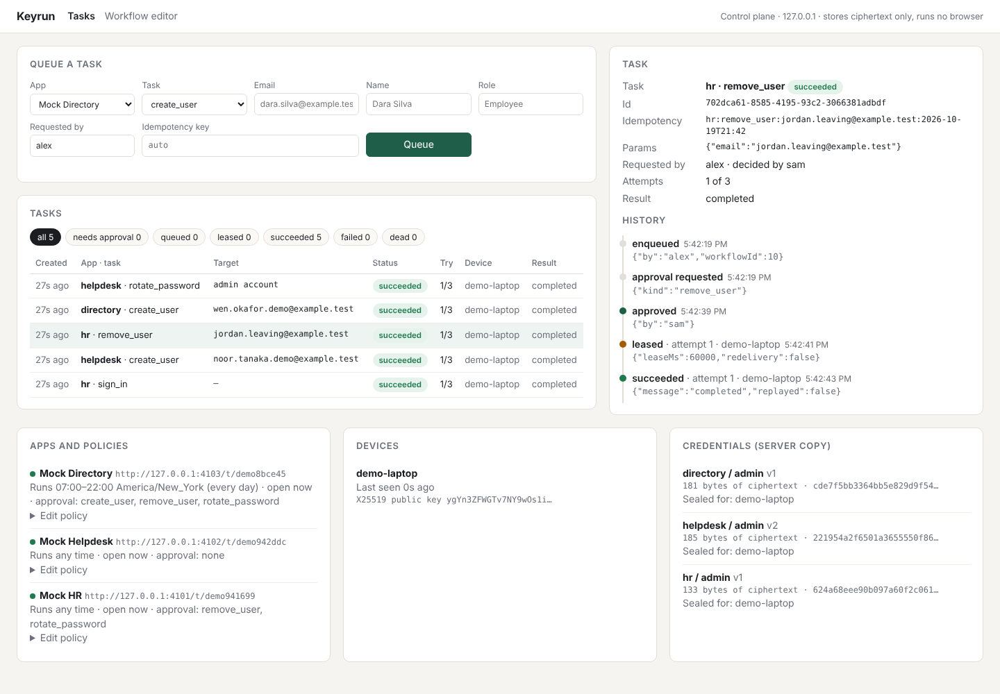
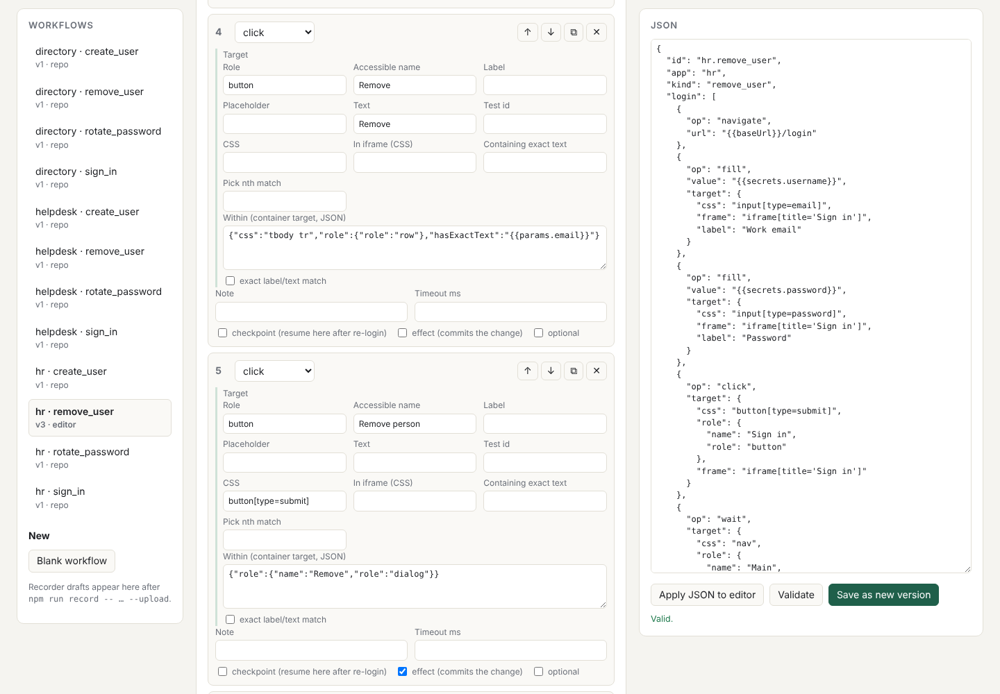
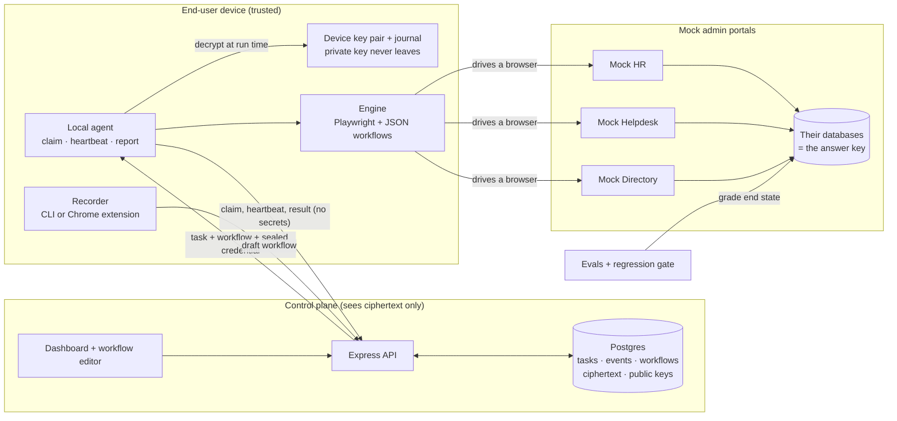

# Keyrun

A browser agent that signs into messy web apps and runs admin tasks (create a user, remove a user, rotate a password) **on the user's own device**, with credentials the server never sees.

It's a small, honest version of the real thing. Everything runs on `127.0.0.1` against three mock admin portals I built to be annoying on purpose. Every result below is checked against the apps' own databases, not against the agent's say-so.

**Stack:** TypeScript, Node 22, Postgres 16, Playwright, libsodium. No frameworks beyond Express and zod.

## What's in here

| Piece | What it does | Where |
|---|---|---|
| Mock apps | Three local admin portals with realistic mess: field ids that change on every load, login inside an iframe, TOTP (including six one-digit boxes), a slow SPA, a consent wall, a "session expired" page, pagination, confirm modals, A/B-tested button labels, a surprise survey popup | `src/mocks/` |
| Engine | Runs JSON workflows with Playwright. Finds elements by role → label → placeholder → text → test id → CSS, with retries and backoff. Handles known interstitials, re-signs in after a session expires and resumes from a checkpoint. Screenshot and trace on every failure, with secrets kept out of the trace | `src/engine/`, `workflows/` |
| Workflow builder | Records clicks and typing into editable steps with several selectors each (CLI recorder or Chrome extension), plus a web editor | `src/recorder/`, `extension/`, `/builder` |
| Control plane | Postgres task queue: leases with fencing tokens, heartbeats, at-least-once delivery, idempotency keys, retries, approvals, allowed hours. Dashboard with every task's history | `src/server/` |
| Local agent | Claims tasks, decrypts the credential on the device only at run time, runs the workflow, reports back. A journal on the device means a retried task never acts twice | `src/agent/` |
| Encryption | XChaCha20-Poly1305 per credential, data key sealed to each device's X25519 key. The server stores ciphertext and public keys only | `src/crypto/` |
| Evals | Every workflow 50 times with randomized mess, graded against the app databases. Success per app, per kind of mess, top failure reasons, and a regression gate | `src/evals/` |

## Results

50 runs of each of the 12 workflows (4 tasks × 3 apps), each run on a fresh tenant with randomly sampled mess (seeded, so reruns see the same scenarios). A run passes only if the agent reported the expected outcome **and** the app's database shows the right end state (user created exactly once, removed, password actually changed). For "create" and "remove", 20% of runs start with the job already done, to check the agent reports "no change needed" instead of acting twice.

<!-- eval:start -->
**600/600 runs passed (100.0%)**, graded against each mock app's database. Silent failures (engine said success, database disagreed): **0**.

Machine: Intel(R) Xeon(R) Processor @ 2.80GHz × 2, 8 GB RAM, linux 6.18.44-fc-v139 (x64); Node v22.22.0, Playwright 1.56.1 (Chromium 141.0.7390.37). 50 runs per workflow, concurrency 3, seed 1, wall time 17 min. Generated 2026-10-19.

| App | Runs | Passed | Success | p50 | p95 |
|---|---:|---:|---:|---:|---:|
| hr | 200 | 200 | 100.0% | 1.8 s | 4.2 s |
| helpdesk | 200 | 200 | 100.0% | 7.4 s | 23.0 s |
| directory | 200 | 200 | 100.0% | 2.5 s | 7.4 s |

| Workflow | Runs | Success | p50 | p95 |
|---|---:|---:|---:|---:|
| directory.create_user | 50 | 100.0% | 3.3 s | 7.5 s |
| directory.remove_user | 50 | 100.0% | 3.1 s | 7.9 s |
| directory.rotate_password | 50 | 100.0% | 2.4 s | 6.5 s |
| directory.sign_in | 50 | 100.0% | 1.6 s | 2.7 s |
| helpdesk.create_user | 50 | 100.0% | 14.2 s | 26.4 s |
| helpdesk.remove_user | 50 | 100.0% | 11.9 s | 24.1 s |
| helpdesk.rotate_password | 50 | 100.0% | 5.4 s | 9.0 s |
| helpdesk.sign_in | 50 | 100.0% | 4.2 s | 7.6 s |
| hr.create_user | 50 | 100.0% | 2.9 s | 5.0 s |
| hr.remove_user | 50 | 100.0% | 2.1 s | 5.5 s |
| hr.rotate_password | 50 | 100.0% | 1.6 s | 2.9 s |
| hr.sign_in | 50 | 100.0% | 1.0 s | 1.3 s |

| Kind of mess (runs where it was in play) | Runs | Success |
|---|---:|---:|
| Field ids/classes change every load | 535 | 100.0% |
| Login form inside an iframe | 400 | 100.0% |
| TOTP second step | 400 | 100.0% |
| Consent overlay blocking clicks (appeared) | 211 | 100.0% |
| Slow single-page app (150 ms – 4.5 s per call) | 200 | 100.0% |
| Session expired mid-task (fired) | 109 | 100.0% |
| Target beyond page 1 of the list | 177 | 100.0% |
| Confirm modal before removal | 127 | 100.0% |
| "What's new" popup (appeared) | 29 | 100.0% |
| A/B copy test renamed the action buttons | 132 | 100.0% |
| Survey popup with no dedicated handler (appeared) | 15 | 100.0% |

No failures in this run.

Locator: 7534 element resolutions; winning strategy share: role 57.0%, label 22.8%, text 11.2%, placeholder 6.0%, css 2.2%, testId 0.8%. 678 resolutions needed a fallback strategy (in 348 runs). Interstitials handled: cookie_banner 202, unknown_popup 11, announcement 21, session_expired 107. Runs with a forced re-login: 107. Runs that repeated a swallowed click: 2.
<!-- eval:end -->

Read the 100% as "the engine handles every kind of mess I built", not "it works on any app". Getting here took five rounds, and the eval caught a real bug in most of them, including a double form submit and a click swallowed by a popup; the full run just before this one was 599/600. The story is in [DESIGN.md](DESIGN.md#what-the-evals-caught).

## What it looks like

The dashboard after `npm run demo`: every task with its status, attempts and device, and the full history of the selected one (enqueued, approval requested, approved by someone else, leased, succeeded). The cards at the bottom are the policies, the enrolled device, and what the server actually holds for each credential: ciphertext.



The workflow editor, here on the HR removal: each step lists several ways to find its element, the row is pinned by the email cell, and the commit click is marked as the `effect`.



## Architecture



**Life of a task.** Someone queues "remove jordan@… from HR" on the dashboard with an idempotency key. HR's policy says removals need approval, so it waits until a second person approves it. Inside HR's allowed hours, the agent on the device claims it with a lease (`FOR UPDATE SKIP LOCKED`), writes "started" to its journal, decrypts the HR credential locally, and runs the workflow: sign in through the iframe, page through the people list, remove the row, confirm the modal. It heartbeats while it works, writes "done" to the journal, then reports. If the device dies at any point, the lease runs out and the task is delivered again; the journal and the workflow's own "is it already done?" checks make sure it still happens exactly once.

## Run it

You need Node 22+ and Postgres 16. Everything binds to `127.0.0.1`.

```bash
npm ci
npx playwright install chromium        # browser for the engine
docker compose up -d                   # Postgres on 127.0.0.1:5432 (or point .env at your own)
cp .env.example .env                   # optional: defaults already match docker compose
npm run db:setup                       # creates keyrun, keyrun_mocks, keyrun_test and migrates
```

No Docker? Any local Postgres 16 works. Create the login once (`createuser -s keyrun`, then `psql -c "alter role keyrun password 'keyrun'" postgres`), or point the three URLs in `.env` at a user you already have.

**The quick look:** one process starts the mock apps, the control plane and an agent, creates demo tenants, enrolls this machine as a device, uploads encrypted credentials and queues a few tasks.

```bash
npm run demo              # add -- --headed to watch the browser
```

Open http://127.0.0.1:4000 (admin token `dev-admin-token`). Three tasks run straight away; two wait for approval. Approve them as someone other than "alex" and watch them run (Directory tasks also only run 07:00–22:00 New York time, to show the allowed-hours policy). The workflow editor is at http://127.0.0.1:4000/builder.

**The pieces one by one**, the way they'd run for real:

```bash
npm run mocks                                    # terminal 1: mock apps on :4101-4103
npm run server                                   # terminal 2: control plane on :4000
npm run demo:setup                               # tenants, device enrollment, encrypted creds, sample tasks
npm run agent -- run                             # terminal 3: the device agent (--headed to watch)

# or by hand:
npm run agent -- enroll --name my-laptop
KEYRUN_CRED_TOTP=<seed> npm run agent -- cred add --app helpdesk --username admin@….test   # prompts for the password
```

**Record a workflow:**

```bash
npm run record -- --url http://127.0.0.1:4101/t/<tenant>/login --app hr --kind offboard --upload
```

A browser opens; use the app, close the window. You get a draft with several selectors per step, secrets as `{{secrets.password}}` placeholders (never the typed value), and anything you typed as a named param. With `--upload` it shows up in the editor. Or load `extension/` as an unpacked extension in Chrome and use its popup; it only runs on `127.0.0.1` and `localhost`.

**Run one workflow directly:**

```bash
KEYRUN_USERNAME=… KEYRUN_PASSWORD=… npm run run:workflow -- --workflow workflows/hr/sign_in.json --base-url http://127.0.0.1:4101/t/<tenant>
```

## Tests, evals, the gate

```bash
npm run typecheck
npm test                    # 51 tests, ~2 min: queue, crypto, engine, agent end to end, recorder, extension, no-plaintext scan
npm run eval                # 600 runs; writes evals/results/ and the table above (~16 min on 2 vCPUs)
npm run eval -- --runs 10   # quicker look
npm run eval:gate           # fails if any success rate dropped below evals/baseline.json
```

The gate compares the overall rate, each app, each workflow and each kind of mess (27 rates) against `evals/baseline.json`, and fails on any drop or any new silent failure (agent said success, database disagreed). With a 100% baseline, one failed run out of 600 fails the build. That's deliberate (see DESIGN.md); pass `--tolerance <points>` if a CI machine is noisy. `npm run eval:baseline` accepts new results. CI (`.github/workflows/ci.yml`) runs all of it on every push.

The test that matters most is `test/no-plaintext.test.ts`. It runs real work through the whole system (sign-ins, two password rotations, a removal, a deliberately failing task), then scans every column of every row of every table in the server's database, and every request body the server received, for every secret in six encodings (raw, URL-encoded, JSON-escaped, hex, base64, base64url). That includes the rotated passwords, which only ever existed on the device.

## Layout

```
src/
  mocks/      three mock portals, the mess, the answer key
  engine/     workflow schema, locator strategies, interstitials, runner, secret-safe tracing
  recorder/   in-page recorder (shared with the extension), events → workflow
  server/     queue, policies, store, Express API, dashboard + editor pages
  agent/      device agent, journal, vault, CLI
  crypto/     libsodium envelope encryption
  evals/      eval runner, report, regression gate
workflows/    12 JSON workflows (3 apps × sign_in, create_user, remove_user, rotate_password)
extension/    minimal MV3 recorder extension
test/         node:test suites
db/           SQL migrations (control plane, mock apps)
evals/        baseline.json, the latest results (incl. every run), and the report from each round
```

## Honest notes

- The mock apps are mine, so I know their mess. The eval shows the engine handles *these* kinds of mess, not that it handles every app. The A/B-label and survey-popup mess were added after the first version of the engine passed, to see what it would do with things it wasn't designed for: it failed, and that's in DESIGN.md.
- Numbers are from a 2-vCPU cloud container running three browser contexts at once. Your laptop will be faster; timing-related failures, if any, will look different.
- The "device" in tests and the demo is a folder on disk (`.keyrun-agent/`, mode 0600). On a real device the private key belongs in the OS keychain or a TPM. See DESIGN.md for that and the rest of what I'd change in production.
- Keyrun only automates loopback URLs. The engine, agent, server and extension all refuse anything else.
